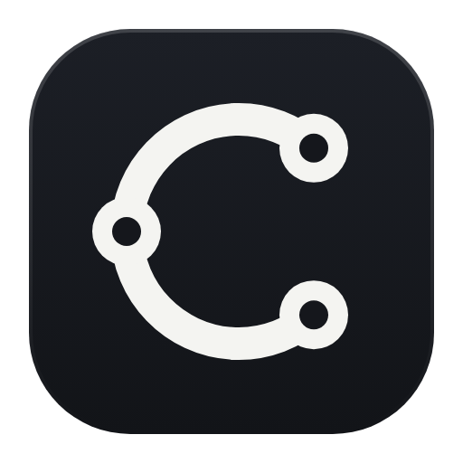
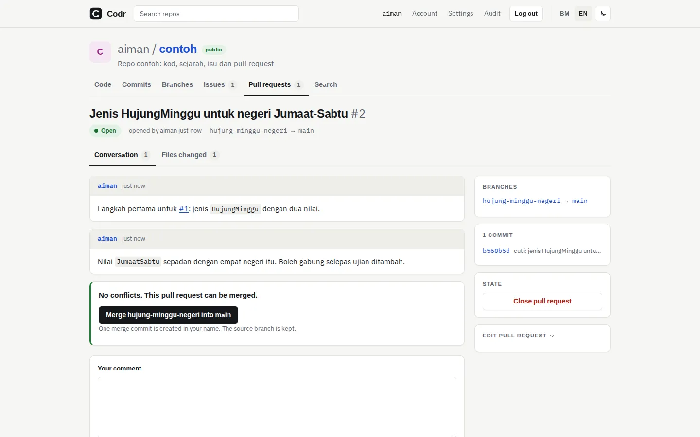

<p align="center"></p>

<h1 align="center">Codr</h1>

<p align="center"><a href="https://github.com/sasateguh/codr/actions/workflows/ci.yml"></a> <a href="https://github.com/sasateguh/codr/releases/latest"></a> <a href="LICENSE"></a></p>

<p align="center"><b>Your code, on your own machine.</b> · <i>Kod anda, di mesin anda.</i><br>
<a href="https://codr.my">codr.my</a> · <a href="https://git.codr.my/aiman/contoh">live example</a> · <a href="docs/design.md">design</a> · <a href="LICENSE">AGPL-3.0-or-later</a> · Built in Malaysia by <a href="https://aimanmalib.com">Aiman Malib</a> · <a href="https://sasateguh.com">Sasa Teguh</a></p>

<p align="center"><picture><source media="(prefers-color-scheme: dark)" srcset="internal/web/static/produk/pr-gelap-en.webp"></picture></p>

Codr is a self-hosted git forge in one Go binary. Your repositories stay plain bare git repositories on disk next to one
SQLite file, so you can always clone straight from the data folder, even with the server stopped. The interface is in
English and Malay, in light and dark, and works on a phone.

[Bahasa Melayu ↓](#bahasa-melayu)

## Why Codr

- **One binary, one folder.** No Postgres, Redis or queue. Back up the data folder, or let `codr backup` take a consistent snapshot while it runs.
- **Real git.** Every transport operation runs the `git` binary itself. Nothing parses packs by hand.
- **Rules on the server.** Protected branches, size limits, required checks and read-only mirrors are enforced for SSH and HTTPS alike.
- **Small enough to read.** One permission function decides who can see what, everywhere. Every decision is written down with its reason and its way back.

## What it does

| | |
|---|---|
| **Code** | File tree with the last commit on each row, syntax highlighting, history, blame, in-repository search, READMEs with their images, Git LFS, a wiki kept in git |
| **Collaboration** | Issues with labels and assignees, pull requests with reviews and line comments, merge, squash or rebase, `fixes #12` closing issues, `owner/repo#12` links, forks |
| **Teams** | Organisations with teams and roles, collaborators, notifications by bell and email, a dashboard feed and profiles filtered by what the viewer may read |
| **CI** | `codr-runner` runs `.codr/ci.toml` jobs on every push in containers with no network; results show as checks, and a protected branch can wait for them ([guide](docs/ci.md)) |
| **Integrations** | REST API with an OpenAPI description, signed webhooks that refuse private addresses, commit statuses, mirrors from GitHub or any URL with their issues and pull requests |
| **Accounts** | SSH keys and scoped tokens, two-step sign-in with recovery codes, signed-in browser list, optional OpenID Connect sign-in |
| **Your data** | `codr backup` takes a consistent snapshot while the server runs and `codr restore` rebuilds an identical install (schedule it with cron or a systemd timer); optional scheduled, encrypted copies in your own S3, R2 or B2 bucket, each downloaded again and verified; a data report and a personal export for every user |
| **AI, if you want it** | Pull request summaries and review notes from a model endpoint you choose. Off until you turn it on, per repository |

## Quick start

You need Linux (amd64 or arm64) and git 2.40 or newer. Docker only if you run CI.

```sh
# 1. the binary: from the latest release (check it against SHA256SUMS on the release page)
curl -fLO https://github.com/sasateguh/codr/releases/latest/download/codr-linux-amd64
sudo install codr-linux-amd64 /usr/local/bin/codr
# 2. a data folder you own
sudo mkdir -p /srv/codr && sudo chown "$USER" /srv/codr
codr init --dir /srv/codr && cd /srv/codr
# 3. an admin, then the servers
printf 'a-long-password\n' | codr admin user add you --admin
codr serve                       # SSH 127.0.0.1:2222 + HTTP 127.0.0.1:3000
```

Then open `http://localhost:3000`, sign in, and add an SSH key or a token under your account. Addresses live in
`config.toml` under `[server]`: `http_addr` / `http_host` and `ssh_addr` / `ssh_host`. `codr doctor` checks the config,
database, git version, hooks, keys and disk space, one line per check. CI is optional: take `codr-runner` from the same
release and follow [docs/ci.md](docs/ci.md).

**From source** (Go 1.27 or newer): `git clone https://github.com/sasateguh/codr && cd codr && go build -o codr ./cmd/codr`,
or `go install codr.my/codr/cmd/codr@latest`. `scripts/build-release.sh vX.Y.Z` builds the release binaries byte for byte.

## Codr and other forges

Codr is for one person or a small team who want a forge they can read end to end. [Gitea](https://about.gitea.com) and
[Forgejo](https://forgejo.org) do much more, and are the better choice if you need it.

| | Codr | Gitea / Forgejo |
|---|---|---|
| Install | one Go binary + git | one Go binary + git |
| Database | SQLite only | SQLite, MySQL, PostgreSQL and others |
| CI | `codr-runner`, jobs with no network by default | Actions-compatible runner and a large catalogue of actions |
| Packages, registries | no | yes |
| Federation | no | in progress (Forgejo) |
| Interface languages | English and Malay, both complete | many languages |
| Licence | AGPL-3.0-or-later | MIT (Gitea), GPL-3.0-or-later (Forgejo) |

## How it is built

Go and `html/template` rendered on the server, one CSS file, no JavaScript framework, a strict CSP with no inline code.
Every user-facing string lives in `locale/*.json`; every tunable value lives in `config.toml` or the settings table.
The gate (`scripts/gate.sh`) runs gofmt, vet, staticcheck, gosec, govulncheck, the race-enabled tests and a browser pass in
Chromium and WebKit (iPhone 13) with axe accessibility checks in both themes. A release is only deployed from a tree that
passed the whole gate.

Read more: [design in one page](docs/design.md) · [CI guide](docs/ci.md) · [changelog](CHANGELOG.md) · [contributing](CONTRIBUTING.md) · [security](SECURITY.md) · [licence](LICENSE)

## Bahasa Melayu

Codr ialah forge git swa-hos dalam satu binari Go. Repo kekal bare repo git biasa di cakera, bersebelahan satu fail
SQLite, jadi anda sentiasa boleh klon terus dari folder data walaupun pelayan berhenti. Antara muka dalam Bahasa Melayu
dan Inggeris, tema cerah dan gelap, dan selesa di telefon.

- **Satu binari, satu folder.** Tiada Postgres, Redis atau baris gilir. Backup folder data, atau `codr backup` untuk snapshot ketika berjalan.
- **Git sebenar.** Setiap operasi git menjalankan binari `git` itu sendiri.
- **Peraturan di pelayan.** Cawangan dilindungi, had saiz, semakan wajib dan cermin baca sahaja dikuatkuasakan untuk SSH dan HTTPS.
- **Cukup kecil untuk dibaca.** Satu fungsi kebenaran menentukan siapa nampak apa. Setiap keputusan direkod dengan sebab dan jalan undurnya.

Ciri: kod (sejarah, jejak baris, carian, LFS, wiki), isu dan pull request (penerima, semakan, ulasan baris, gabung/squash/rebase,
`fixes #12`), organisasi dan pasukan, fork, pemberitahuan loceng dan emel, CI `codr-runner` dalam kontena tanpa rangkaian
([panduan](docs/panduan-ci.md)), API REST + OpenAPI, webhook bertandatangan, cermin GitHub, log masuk dua langkah dan OpenID Connect,
`codr backup` dan `codr restore`, salinan awan bersulit berjadual, laporan data dan eksport peribadi, serta AI pilihan yang mati secara lalai.
Reka bentuk dalam satu halaman: [docs/reka-bentuk.md](docs/reka-bentuk.md).

## Licence

Codr is free software under the [GNU Affero General Public License v3.0 or later](LICENSE). You may use, change and
host it, including for your company. If you change the server and let other people use it over a network, share your
changes with them under the same licence. For other terms, write to admin@sasateguh.com.

Made by [Aiman Malib](https://aimanmalib.com) at [Sasa Teguh](https://sasateguh.com), Malaysia. Codr was developed in a
private repository from October 2026 and has hosted its author's own code since then; this public repository starts at
v2.29.0 with one squashed commit, so the history before that is not here. See the [changelog](CHANGELOG.md).
